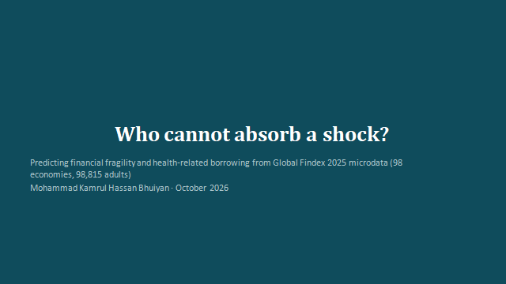
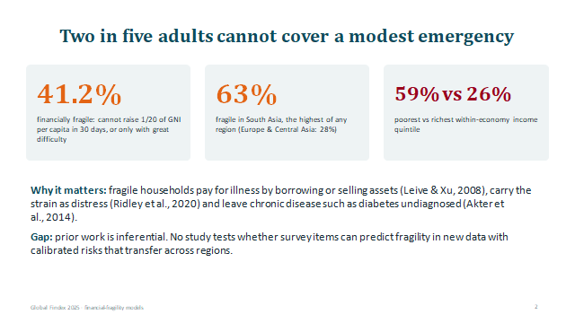
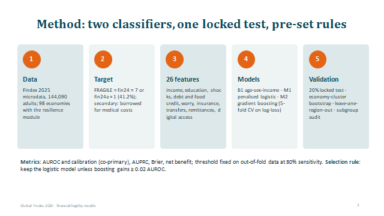
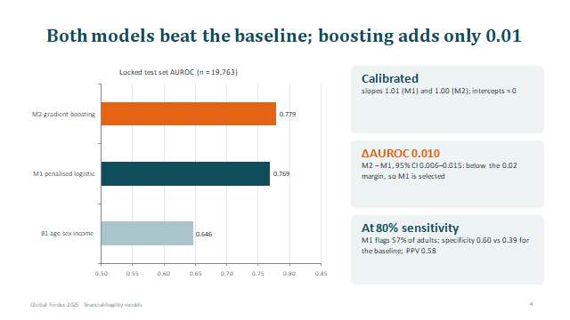
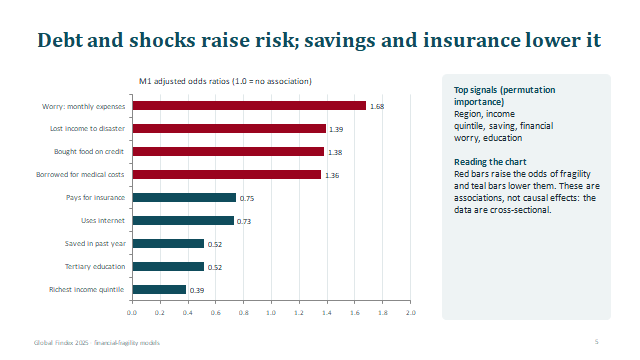
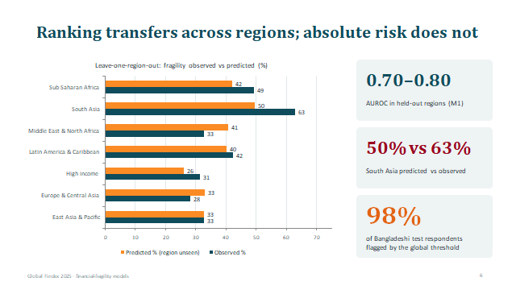
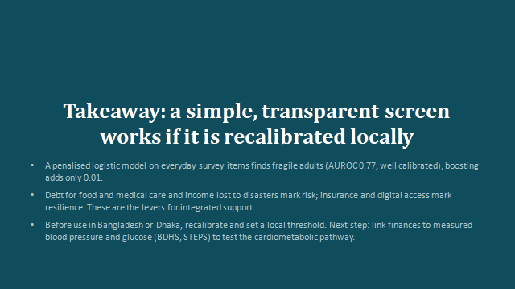

## Problem
Who Cannot Absorb a Shock? Predicting Financial Fragility and Health-Related Borrowing from Global Findex 2025 Microdata

## Methods:
two classifiers, one locked test, pre-set rules

Metrics: AUROC and calibration (co-primary), AUPRC, Brier, net benefit; threshold fixed on out-of-fold data at 80% sensitivity. Selection rule: keep the logistic model unless boosting gains ≥ 0.02 AUROC

## Result:
Debt and shocks raise risk; savings and insurance lower it
Ranking transfers across regions; absolute risk does not

## Takeaway
A simple, transparent screen works if it is recalibrated locally

